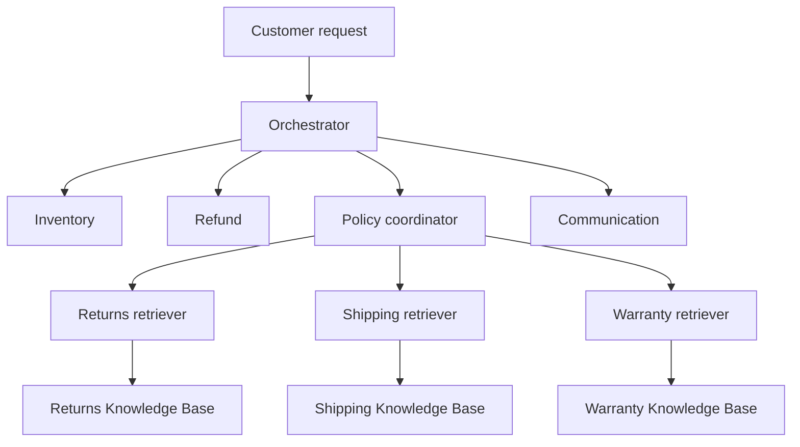
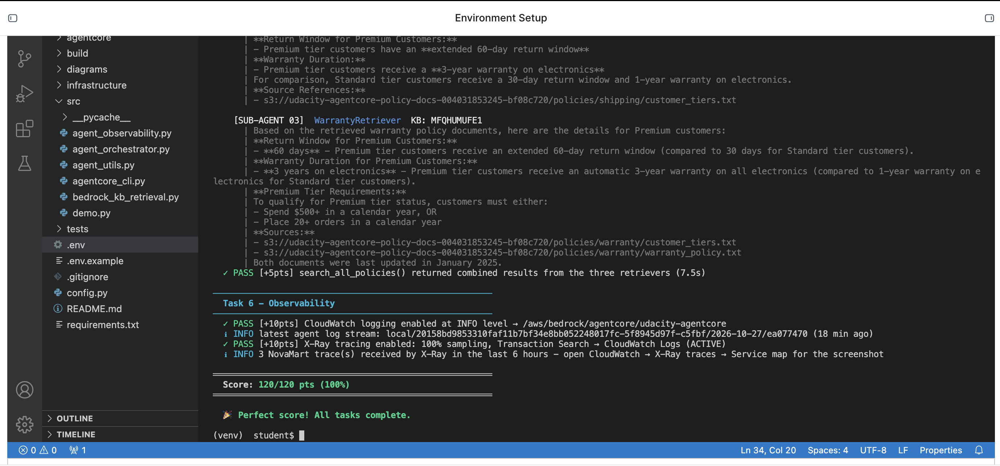
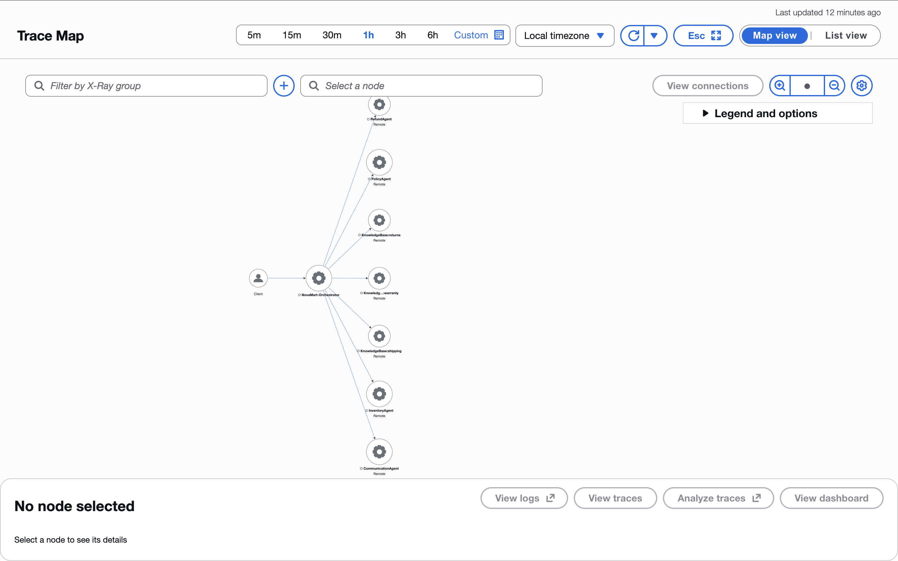

# Multi-Agent E-Commerce RAG

**An AWS customer-support project by [Sileye Sarr](https://github.com/Sileye00), completed through the AWS / Udacity Future AWS Agent Engineer Nanodegree.**

I implemented a system that routes e-commerce support requests among specialist agents, retrieves policy information from three Knowledge Bases in parallel, and stores workflow findings in DynamoDB. The application was deployed to Amazon Bedrock AgentCore Runtime and passed the supplied project checks with **120/120 points**.

NovaMart is the fictional retailer used in the course starter. This repository contains my completed project implementation, the supporting project files, and a portfolio case study with architecture, evidence, and lessons learned. It includes only the capstone project, not the rest of the course. Deployment-specific settings are excluded; `.env.example` documents the required configuration.

## The problem

A return request requires several different kinds of work: finding an order, identifying the customer tier, checking the applicable policy, evaluating the request, and explaining the outcome. I used specialist agents with shared workflow state to make those responsibilities explicit and traceable.

## Architecture

The diagram shows logical delegation. Routing tools read and update a shared DynamoDB WorkflowState record. The Policy coordinator invokes the three retrievers with `ThreadPoolExecutor(max_workers=3)` and gathers their findings with `as_completed()`. Communication composes the final response after the relevant workers run.

| Agent | Model configuration | Responsibility |
|---|---|---|
| Orchestrator | Claude Haiku 4.5, temperature 0.0 | Initialize sessions and route requests |
| Inventory | Claude Sonnet 4.5, temperature 0.1 | Retrieve orders and customer profiles |
| Refund | Claude Sonnet 4.5, temperature 0.1 | Evaluate return requests and record return initiation |
| Policy coordinator | Claude Sonnet 4.5, temperature 0.2 | Combine findings from three retrievers |
| Policy retrievers | Claude Sonnet 4.5, temperature 0.0 | Retrieve and summarize their domain's passages |
| Communication | Claude Sonnet 4.5, temperature 0.3 | Draft the final customer response |

Model IDs are selected through configuration constants.

## What I implemented

I completed the agent builders, tool implementations, system prompts, and routing functions in the supplied `agent_orchestrator.py` skeleton. My implementation included:

- **Order and account lookup:** DynamoDB reads using the order table's composite customer/order key, plus pagination for customer order history.
- **Shared state:** Routing tools read the workflow version before invoking a worker, then save the result through the supplied helper with `expected_version`.
- **Return handling:** The Refund Agent uses 30-day Standard and 60-day Premium windows. Its mutation tool requires a reason and conditionally changes a delivered order to `return_requested`, saving a reference and reason. It records a request; it does not transfer funds or generate a shipping label.
- **Parallel RAG:** Three domain retrievers search Returns, Shipping, and Warranty independently, returning labeled findings and source references.
- **Safety configuration:** Content filtering, blocking card numbers and SSNs, anonymizing emails and phone numbers, denied topics, profanity filtering, and publication of a numbered guardrail version.
- **Deployment and observability:** Integration with the supplied AgentCore CLI wrapper and observability helper, including runtime configuration, CloudWatch INFO logs, and X-Ray tracing at 100% sampling for development.
- **Memory resource:** A session-summary strategy with seven-day event retention.

I created and synced three self-managed Bedrock Knowledge Bases using Titan Embed Text v2 and the existing S3 Vectors bucket and domain indexes created by the foundation stack.

## Stack

Python · Strands Agents SDK · Amazon Bedrock · Amazon Bedrock AgentCore Runtime and Memory · Bedrock Guardrails · DynamoDB · Amazon S3 · S3 Vectors · CloudFormation · CloudWatch · AWS X-Ray

## Validation and results

| Check | Observed result |
|---|---|
| Agent architecture checks | 40/40 |
| Knowledge Base and retrieval checks | 25/25 |
| Full supplied test suite | **120/120** |
| Live return scenario | Inventory → Refund → Communication; requested a missing reason without initiating a return |
| Live policy scenario | Three parallel retrievers → Policy → Communication |
| Live arithmetic scenario | Communication returned **$134.96** for five items at $29.99 with 10% off |
| Deployed runtime invocation | The same arithmetic request returned **$134.96**, reported from the deployed endpoint |
| Trace evidence | Orchestrator, four workers, and three Knowledge Base nodes appeared in CloudWatch Trace Map |

The supplied checks validate selected structure and AWS resource configuration. A perfect score does not establish that every conversational behavior or failure path is correct. Results document the tested deployment; this repository does not promise an always-on demo endpoint.

### Automated test evidence

### Live trace evidence

The supplied tracing layer displays the Knowledge Base nodes directly connected to the Orchestrator in this map. The screenshot should not be interpreted as a separate Policy → Knowledge Base edge.

## Lessons learned

**A successful stack deployment can still use the wrong resource type.** My original workspace template created an ordinary S3 bucket where the updated assignment expected an S3 Vectors bucket. I aligned the workspace with the official starter. CloudFormation rejected changing the resource type under the same logical ID, so I recreated the foundation. Emptying all versions from the policy bucket was necessary before its deletion could finish.

**Creating a Knowledge Base and indexing documents are separate steps.** Each domain needed the correct S3 prefix, embedding model, existing vector index, and a successful sync before retrieval could return passages.

**Shared workflow state and conversation memory solve different problems.** WorkflowState carries worker findings through a request. Creating a summary-memory resource does not, by itself, prove that the application writes conversation events or recalls summaries.

**Live runs reveal gaps that structural tests miss.** I observed initialization retries and an unverified Premium-tier assumption even though the supplied suite passed. The traces and saved findings made these behaviors visible.

## Current limitations and next improvements

- Return-window enforcement relies on model reasoning. A stronger implementation would validate tier and dates in deterministic code before any write. The seeded data uses order dates, while the policy describes a window from delivery; this needs an explicit, verified delivery timestamp.
- The recorded return scenario did not call the mutation tool because no reason was supplied. Additional checks should exercise approved returns, expired windows, duplicate requests, and denied mutations.
- Communication should distinguish a general question about Premium benefits from verified membership in that tier.
- The supplied workflow reader uses eventually consistent reads. Initialization retries were observed; stronger reads and sequential initialization deserve investigation.
- The supplied test runner reuses agent objects across scenarios. Isolating agent conversation state by customer/session would reduce the risk of context leakage.
- Guardrail configuration passed the supplied checks, but that is not a substitute for a dedicated adversarial evaluation. Nested retriever agents also need explicit review of guardrail coverage.
- Account authentication, deterministic money calculations, robust session authorization, and application-level conversation recall are future improvements rather than completed production features.

## Attribution

Built from the [Udacity AWS Agentic AI classroom starter](https://github.com/udacity/cd14764-aws-agentic-c3-classroom/tree/main/project/starter).

Udacity supplied the foundation template, seed data, configuration, tests, retrieval helper, tracing/logging utilities, and AgentCore CLI wrapper. I completed the assignment TODOs, provisioned the Knowledge Bases, deployed the application, ran the validations, and captured the evidence. This is an educational implementation, not an independently authored replacement for those supplied components.

The original [Udacity license](LICENSE.md) is retained. The project is based on the upstream educational material; attribution and the upstream terms continue to apply. This repository does not relicense the supplied course material.

## Project files

| Path | Contents |
|---|---|
| `src/agent_orchestrator.py` | Completed agent builders, routing tools, guardrail, deployment, memory, and observability TODOs |
| `src/` support modules | Supplied retrieval, tracing, CLI, terminal utilities, and demo |
| `infrastructure/` | Foundation template, seed script, and cleanup utility |
| `tests/test_agent.py` | Original project checks, unchanged |
| `config.py` | Original project configuration |
| `.env.example` | Configuration template with empty deployment IDs |
| `screenshots/` | Test score and trace evidence |

For the original setup walkthrough, see the [official project README](https://github.com/udacity/cd14764-aws-agentic-c3-classroom/blob/main/project/starter/README.md). The implementation TODOs are complete in this version. Create your own `.env` from `.env.example`, provision your own foundation and Knowledge Bases, and use your own AWS credentials before running live commands.

## Author

[Sileye Sarr](https://github.com/Sileye00) · [Portfolio](https://sileyesarr.com)
